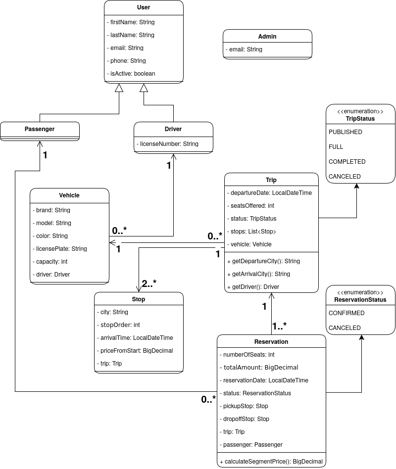

# CoVehicle

Carpooling platform with multi-stop trips. A driver publishes a trip as an ordered list of stops with cities, arrival times, and cumulative prices. A passenger searches for a segment (pick-up city, drop-off city, date) and books one or more seats. The segment price is the difference between the drop-off and pick-up stop prices.

**Example.** Hamid publishes a trip with four stops: Rabat (0 DH), Casablanca (40 DH), Settat (70 DH), Marrakech (120 DH). A passenger who boards at Casablanca and leaves at Marrakech pays 120 - 40 = 80 DH per seat.

## Tech Stack

| Technology | Version |
|---|---|
| Java | 25 |
| Spring Boot | 4.1.2 |
| Maven | (wrapper `mvnw`) |
| PostgreSQL | 18 |
| Spring Data JPA / Hibernate | (via Spring Boot) |
| MapStruct | 1.6.3 |
| Lombok | (via Spring Boot) |
| Bean Validation (Jakarta) | (via Spring Boot) |
| springdoc OpenAPI (Swagger UI) | 3.1.1 |
| JUnit 5 | (via Spring Boot) |
| Mockito | (via Spring Boot) |
| AssertJ | (via Spring Boot) |
| Docker Compose | 2.x |

## Architecture

### Layered Structure

```
controller  →  service interface  →  service impl  →  repository
                                      ↓
                                    mapper (MapStruct)
                                      ↓
                                    DTO (Java records)
```

### Package Tree

```
org.multivehicle.covehicle
├── CoVehicleApplication.java
├── advice/
│   └── GlobalExceptionHandler.java
├── config/
│   ├── DatabaseInitializer.java
│   ├── DatabaseInitializerPostProcessor.java
│   └── LocalDataSeeder.java
├── controller/
│   ├── DriverController.java
│   ├── PassengerController.java
│   ├── ReservationController.java
│   ├── TripController.java
│   └── VehicleController.java
├── dto/
│   ├── request/
│   │   ├── DriverRequest.java
│   │   ├── PassengerRequest.java
│   │   ├── ReservationRequest.java
│   │   ├── StopRequest.java
│   │   ├── TripRequest.java
│   │   └── VehicleRequest.java
│   └── response/
│       ├── DriverResponse.java
│       ├── PassengerResponse.java
│       ├── ReservationResponse.java
│       ├── StopResponse.java
│       ├── TripResponse.java
│       ├── TripSearchResult.java
│       ├── VehicleResponse.java
│       └── VehicleSummary.java
├── entity/
│   ├── Admin.java
│   ├── Reservation.java
│   ├── Stop.java
│   ├── Trip.java
│   ├── Vehicle.java
│   ├── enums/
│   │   ├── ReservationStatus.java
│   │   └── TripStatus.java
│   └── users/
│       ├── Driver.java
│       ├── Passenger.java
│       └── User.java
├── exception/
│   ├── BaseException.java
│   ├── badrequest/
│   ├── conflict/
│   ├── forbidden/
│   ├── internalservererror/
│   └── notfound/
├── mapper/
│   ├── DriverMapper.java
│   ├── PassengerMapper.java
│   ├── ReservationMapper.java
│   ├── StopMapper.java
│   ├── TripMapper.java
│   └── VehicleMapper.java
├── repository/
│   ├── AdminRepository.java
│   ├── DriverRepository.java
│   ├── PassengerRepository.java
│   ├── ReservationRepository.java
│   ├── StopRepository.java
│   ├── TripRepository.java
│   ├── VehicleRepository.java
│   ├── UserRepository.java
│   └── projection/
│       └── TripReservedSeats.java
└── service/
    ├── DriverService.java
    ├── PassengerService.java
    ├── ReservationService.java
    ├── TripService.java
    ├── VehicleService.java
    └── impl/
        ├── DriverServiceImpl.java
        ├── PassengerServiceImpl.java
        ├── ReservationServiceImpl.java
        ├── TripServiceImpl.java
        └── VehicleServiceImpl.java
```

### Entity Model



- **User** (base class, `JOINED` inheritance) with `firstName`, `lastName`, `email`, `phone`, `isActive`.
- **Driver** extends User with unique `licenseNumber`.
- **Passenger** extends User (no extra fields).
- **Admin** is a standalone entity (not a User) with just `id` and unique `email`.
- **Vehicle** belongs to one Driver: `brand`, `model`, `color`, unique `licensePlate`, `capacity` (1-8).
- **Trip** belongs to one Vehicle: `seatsOffered`, `status` (PUBLISHED → FULL/COMPLETED/CANCELED), `departureDate` (derived from first stop).
- **Stop** belongs to one Trip: `city`, `stopOrder`, `arrivalTime`, `priceFromStart`. Unique constraints on (trip, city) and (trip, stopOrder).
- **Reservation** links a Passenger to a Trip via a pickup Stop and a drop-off Stop: `numberOfSeats`, `totalAmount`, `reservationDate`, `status` (CONFIRMED/CANCELED).

## Getting Started

### Prerequisites

- JDK 25
- Docker & Docker Compose (for database and containerized runs)
- A local PostgreSQL server (for the `local` profile without Docker)

### Running the Application

#### (a) Local profile with a local PostgreSQL server

1. Create a `.env` file in the project root:

```properties
DB_PORT=5432
DB_NAME=cv_db
DB_USERNAME=postgres
DB_PASSWORD=your_password
```

2. Start PostgreSQL locally (e.g. via `docker compose up -d postgres` or your own installation).

3. Run the application from the IDE or with `./mvnw spring-boot:run`.

The `local` profile is the default. It imports `.env`, sets the database host to `localhost`, and uses `DatabaseInitializer` to create the database when it does not exist.

#### (b) Docker Compose for PostgreSQL + app from the IDE

1. Create the `.env` file as above.

2. Create `secret/db.password.txt` with the same password as `DB_PASSWORD` in `.env` (no trailing newline):

```bash
printf 'your_password' > secret/db.password.txt
```

3. Start only the database container:

```bash
docker compose up -d postgres
```

4. Run the application from the IDE (default `local` profile). The app connects to the containerized PostgreSQL via the port mapped in `docker-compose.yml`.

Note: If a local PostgreSQL instance already uses port 5432, set `DB_PORT=5433` in `.env`. Docker Compose reads `.env` and publishes that host port.

#### (c) Fully containerized with Docker Compose

1. Create the password file (no trailing newline):

```bash
printf 'your_password' > secret/db.password.txt
```

2. Build and start both services:

```bash
docker compose --profile app up --build
```

The `app` service uses the `docker` profile, which reads the password from Docker secrets (`/run/secrets/DB_PASSWORD`) and connects to the `postgres` service by its container name.

### Seed Data

The seeder runs on profiles `local` and `docker`, but **only when the `drivers` table is empty**. On subsequent starts the seed data is skipped.

To reseed, remove the persisted data and restart:

```bash
docker compose down -v
```

Or drop the database manually and restart the application.

#### Seeded Entities

| # | Driver | Email |
|---|---|---|
| 1 | Hamid Alami | hamid@covehicle.local |
| 2 | Youssef El Amrani | youssef@covehicle.local |
| 3 | Fatima Idrissi | fatima@covehicle.local |
| 4 | Omar Benjelloun | omar@covehicle.local |
| 5 | Sara El Fassi | sara@covehicle.local |

| # | Passenger | Email |
|---|---|---|
| 6 | Salma Bennani | salma@covehicle.local |
| 7 | Karim Tazi | karim@covehicle.local |
| 8 | Imane Idrissi | imane@covehicle.local |
| 9 | Mehdi Alaoui | mehdi@covehicle.local |
| 10 | Nadia Chraibi | nadia@covehicle.local |

| # | Admin | Email |
|---|---|---|
| 1 | - | admin1@covehicle.local |
| 2 | - | admin2@covehicle.local |
| 3 | - | admin3@covehicle.local |
| 4 | - | admin4@covehicle.local |
| 5 | - | admin5@covehicle.local |

| # | Vehicle | Driver | Plate |
|---|---|---|---|
| 1 | Dacia Logan (Grey) | Hamid | HAM-1234 |
| 2 | Renault Clio (Blue) | Youssef | YOU-2345 |
| 3 | Peugeot 208 (White) | Fatima | FAT-3456 |
| 4 | Toyota Yaris (Red) | Omar | OMA-4567 |
| 5 | Hyundai i10 (Black) | Sara | SAR-5678 |

| # | Trip | Driver | Vehicle | Status | Route |
|---|---|---|---|---|---|
| 1 | Hamid's trip | Hamid | Dacia Logan | PUBLISHED | Rabat → Casablanca → Settat → Marrakech |
| 2 | Full trip | Youssef | Renault Clio | FULL | Rabat → Casablanca → Marrakech |
| 3 | Completed trip | Fatima | Peugeot 208 | COMPLETED | Casablanca → Settat → Marrakech |
| 4 | Canceled trip | Omar | Toyota Yaris | CANCELED | Rabat → Fes |
| 5 | Soon trip | Sara | Hyundai i10 | PUBLISHED | Casablanca → Rabat |

| # | Reservation | Passenger | Trip | Stops | Seats | Status |
|---|---|---|---|---|---|---|
| 1 | R1 | Salma | Full trip (#2) | Casablanca → Marrakech | 1 | CONFIRMED |
| 2 | R2 | Karim | Full trip (#2) | Rabat → Marrakech | 1 | CONFIRMED |
| 3 | R3 | Mehdi | Completed trip (#3) | Casablanca → Marrakech | 1 | CONFIRMED |
| 4 | R4 | Nadia | Completed trip (#3) | Casablanca → Settat | 1 | CANCELED |
| 5 | R5 | Imane | Canceled trip (#4) | Rabat → Fes | 1 | CANCELED |
| 6 | R6 | Nadia | Soon trip (#5) | Casablanca → Rabat | 1 | CONFIRMED |

#### Seeded Stops

| # | Trip | City | Stop Order |
|---|---|---|---|
| 1 | Hamid's trip (#1) | Rabat | 0 |
| 2 | Hamid's trip (#1) | Casablanca | 1 |
| 3 | Hamid's trip (#1) | Settat | 2 |
| 4 | Hamid's trip (#1) | Marrakech | 3 |
| 5 | Full trip (#2) | Rabat | 0 |
| 6 | Full trip (#2) | Casablanca | 1 |
| 7 | Full trip (#2) | Marrakech | 2 |
| 8 | Completed trip (#3) | Casablanca | 0 |
| 9 | Completed trip (#3) | Settat | 1 |
| 10 | Completed trip (#3) | Marrakech | 2 |
| 11 | Canceled trip (#4) | Rabat | 0 |
| 12 | Canceled trip (#4) | Fes | 1 |
| 13 | Soon trip (#5) | Casablanca | 0 |
| 14 | Soon trip (#5) | Rabat | 1 |

Note: Trip departure dates are computed relative to the current time at seed ("tomorrow" and "departing in 2 hours" are fixed at first start), so the exact dates will differ each time you reseed. Reseed before a demo to ensure the time-relative trips are in the expected state. Passenger IDs start at 6 because the `users` table identity sequence is shared across Drivers and Passengers (5 drivers inserted first, then 5 passengers). On a fresh seed: drivers are 1–5, passengers are 6–10, admins are 1–5, vehicles are 1–5, trips are 1–5, stops are 1–14, and reservations are 1–6.

## API Reference

Swagger UI is available at `http://localhost:8080/swagger-ui.html`.

### Drivers

| Method | Path | Purpose | Success |
|---|---|---|---|
| POST | `/api/drivers` | Create a driver | 201 Created |
| GET | `/api/drivers/{id}` | Get driver by ID | 200 OK |
| GET | `/api/drivers` | List all drivers | 200 OK |
| PUT | `/api/drivers/{id}` | Update a driver | 200 OK |
| GET | `/api/drivers/search?q=` | Search drivers by name or email | 200 OK |

### Passengers

| Method | Path | Purpose | Success |
|---|---|---|---|
| POST | `/api/passengers` | Create a passenger | 201 Created |
| GET | `/api/passengers/{id}` | Get passenger by ID | 200 OK |
| GET | `/api/passengers` | List all passengers | 200 OK |
| PUT | `/api/passengers/{id}` | Update a passenger | 200 OK |
| GET | `/api/passengers/by-email?email=` | Find passenger by email | 200 OK |

### Vehicles

| Method | Path | Purpose | Success |
|---|---|---|---|
| POST | `/api/drivers/{driverId}/vehicles` | Register a vehicle for a driver | 201 Created |
| GET | `/api/drivers/{driverId}/vehicles` | List vehicles of a driver | 200 OK |
| GET | `/api/drivers/{driverId}/vehicles/{vehicleId}` | Get vehicle by ID | 200 OK |
| PUT | `/api/drivers/{driverId}/vehicles/{vehicleId}` | Update a vehicle | 200 OK |
| DELETE | `/api/drivers/{driverId}/vehicles/{vehicleId}` | Delete a vehicle | 204 No Content |

### Trips

| Method | Path | Purpose | Success |
|---|---|---|---|
| POST | `/api/drivers/{driverId}/trips` | Publish a new trip | 201 Created |
| GET | `/api/trips/search` | Search trips by segment | 200 OK |
| GET | `/api/trips/{id}` | Get trip detail with stops | 200 OK |
| GET | `/api/drivers/{driverId}/trips` | List trips of a driver | 200 OK |
| GET | `/api/drivers/{driverId}/trips/{tripId}/reservations` | List reservations on a trip | 200 OK |
| POST | `/api/drivers/{driverId}/trips/{tripId}/complete` | Mark a trip as completed | 204 No Content |
| POST | `/api/drivers/{driverId}/trips/{tripId}/cancel` | Cancel a trip | 204 No Content |

Search parameters: `departureCity`, `arrivalCity`, `date` (yyyy-MM-dd), `seats` (default 1), `maxPrice` (optional), `page` (default 0), `size` (default 10, max 50).

### Reservations

| Method | Path | Purpose | Success |
|---|---|---|---|
| POST | `/api/passengers/{passengerId}/reservations` | Book seats on a trip | 201 Created |
| DELETE | `/api/passengers/{passengerId}/reservations/{reservationId}` | Cancel a reservation | 204 No Content |
| GET | `/api/passengers/{passengerId}/reservations` | List passenger's reservations | 200 OK |

### Postman Collection

The `/postman` directory contains a Node.js script that generates a Postman collection and environment file.

```bash
node postman/build_collection.js
```

This produces `postman/CoVehicle.postman_collection.json` and `postman/CoVehicle.local.postman_environment.json`. Import both into Postman, or run headlessly with Newman:

```bash
npx newman run postman/CoVehicle.postman_collection.json -e postman/CoVehicle.local.postman_environment.json
```

Note: S10 and S11 depend on the seed data. S11 cannot be rerun without reseeding the database.

## Error Handling

All error responses use the RFC 7807 **ProblemDetail** format. Every response contains at least these five fields:

```json
{
  "timestamp": "2025-06-15T10:30:00Z",
  "status": 409,
  "type": "urn:covehicle:error:conflict",
  "title": "Conflict",
  "detail": "1 seats left on this trip",
  "instance": "/api/passengers/1/reservations"
}
```

For Bean Validation failures (`400 Bad Request`), an additional `fieldErrors` map is included:

```json
{
  "timestamp": "2025-06-15T10:30:00Z",
  "status": 400,
  "type": "urn:covehicle:error:validation-error",
  "title": "Bad Request",
  "detail": "Validation failed",
  "instance": "/api/drivers/1/trips",
  "fieldErrors": {
    "seatsOffered": "must be greater than or equal to 1"
  }
}
```

### Status Codes

| Code | Exception | When |
|---|---|---|
| 400 Bad Request | `BadRequestException`, validation errors | Invalid search criteria, invalid stop sequence, invalid segment, seats exceed capacity, Bean Validation failure |
| 403 Forbidden | `ForbiddenException` | Driver tries to manage another driver's trip or vehicle, passenger tries to cancel another's reservation |
| 404 Not Found | `NotFoundException` | Driver, passenger, vehicle, trip, stop, or reservation not found |
| 409 Conflict | `ConflictException`, `DataIntegrityViolationException` | Duplicate reservation, insufficient seats, illegal trip/reservation state, cancellation too late (< 24h), duplicate email/license/plate, vehicle in use |
| 500 Internal Server Error | `InternalServerErrorException`, unexpected | Unexpected server errors |

## Business Rules and Design Decisions

- **Segment price** = drop-off stop's `priceFromStart` minus pick-up stop's `priceFromStart`. The `totalAmount` = segment price x number of seats.
- **Remaining seats and segment price are computed**, never stored as columns.
- **One CONFIRMED reservation per passenger per trip.** A second booking on the same trip is rejected.
- **24-hour cancellation window.** A passenger may cancel only if the current time is at least 24 hours before the trip's `departureDate`.
- **Automatic PUBLISHED/FULL transitions.** When a booking fills the last available seat, the trip status changes to FULL. When a reservation on a FULL trip is canceled, it reverts to PUBLISHED.
- **Trip cancellation cancels all confirmed reservations** in one transaction via a bulk `UPDATE` query.
- **Pessimistic write lock** (`PESSIMISTIC_WRITE`) on the Trip entity when booking and when canceling a reservation, to prevent overbooking under concurrent requests.
- **`Trip.departureDate` is derived** from the first stop's `arrivalTime` at publish time.
- **Search "date" filters** the pick-up stop's `arrivalTime` (start of day to start of next day). Results are sorted by `Trip.departureDate` ascending.
- **Booking is refused after the trip's departure date** has passed.
- **Stops are matched case-insensitively** in search (`LOWER(city)`). Cities are stored trimmed.
- **No authentication.** The driver and passenger identities come from the URL path variables (`{driverId}`, `{passengerId}`). Ownership is verified server-side.

### Enum Mapping

The brief uses French status names. The code uses English enum values:

| Brief (French) | TripStatus (English) |
|---|---|
| PUBLIE | PUBLISHED |
| COMPLET | FULL |
| TERMINE | COMPLETED |
| ANNULE | CANCELED |

| Brief (French) | ReservationStatus (English) |
|---|---|
| CONFIRMEE | CONFIRMED |
| ANNULEE | CANCELED |

## Queries

### Trip Search

The search endpoint executes a single JPQL query that:

1. Joins `Trip` → `Vehicle` → `Driver` for the driver name and vehicle summary.
2. Joins `Trip.stops` twice (aliased as `pickup` and `dropoff`) to match the requested cities.
3. Checks `pickup.stopOrder < dropoff.stopOrder` to ensure a valid forward segment.
4. Filters `pickup.arrivalTime` within the requested date range (start of day to start of next day).
5. Computes the **segment price** in the projection: `dropoff.priceFromStart - pickup.priceFromStart`.
6. Computes **remaining seats** via a correlated subquery: `seatsOffered - COALESCE(SUM(r.numberOfSeats), 0)` over CONFIRMED reservations.
7. Filters on `status = PUBLISHED` and `remainingSeats >= requestedSeats`.
8. Optionally filters on `segmentPrice <= maxPrice`.
9. Returns a paginated result with a separate count query for total pages.

Results are sorted by `Trip.departureDate ASC, Trip.id ASC`.

### Trip Detail (avoiding N+1)

The `findDetailById` query uses `JOIN FETCH` on `vehicle`, `vehicle.driver`, and `stops` to load the entire trip graph in a single SQL statement, avoiding the N+1 problem when serializing the response.

Similarly, `findByDriverIdWithDetails` and `ReservationRepository.findHistory` use `JOIN FETCH` to load all associations eagerly in dedicated queries.

## Testing

Run all tests with the Maven wrapper:

```bash
./mvnw test
```

### Test Classes

| Class | Type | Scenarios |
|---|---|---|
| `TripServiceImplTest` | Unit (Mockito) | Publish: valid trip with trimmed/ordered stops, seats exceed capacity, vehicle owned by another driver, fewer than 2 stops, past departure, duplicate city, non-increasing prices, non-increasing times, first stop non-zero price. Complete: non-owner, not yet departed, valid completion. Cancel: cascades to reservations, rejects final state. |
| `ReservationServiceImplTest` | Unit (Mockito) | Book: valid booking with correct segment price, booking that marks trip FULL, unknown passenger/trip/stop, stop from another trip, pick-up after drop-off, booking a FULL trip, booking after departure, duplicate confirmed reservation, insufficient seats. Cancel: frees seats and restores FULL→PUBLISHED, rejects within 24h window, rejects non-owner, rejects already canceled. |
| `CoVehicleApplicationTests` | Integration | Context loads (requires a running PostgreSQL instance on the configured `DB_PORT`). |

To run only the unit tests (no database required):

```bash
./mvnw test -Dtest="*ServiceImplTest"
```

## Project Management

- **Jira board:** _(link to be added)_
- **GitHub repository:** _(link to be added)_
